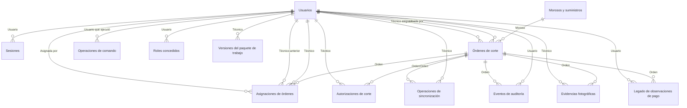

# Modelo de datos del piloto

Fuente: `backend/sql/001_init.sql`, `backend/sql/002_evidence_assets.sql`, `backend/sql/003_payment_observations.sql`, `backend/sql/003_reference_fields.sql`, `backend/sql/007_role_grants.sql`, `backend/sql/007_work_package_versions.sql` y `backend/sql/008_reconnection_schema.sql`. Relaciones leídas de las cláusulas `REFERENCES` y verificadas contra el esquema.
Fecha: 2026-10-13
Estado: entrega, copia fechada. Modelo del piloto provisional; no es el modelo oficial de SEPSA (`docs/DOMAIN.md`).

Este modelo tiene 13 tablas y 21 relaciones. El diccionario de columnas está en [05-diccionario-datos.md](05-diccionario-datos.md). Los términos y los estados están en el [glosario de términos y estados](05-diccionario-datos.md#glosario-de-términos-y-estados).

## Resumen para presentar

El sistema guarda, en 13 tablas, lo siguiente:

- **Acceso:** Quién puede entrar al sistema y con qué rol. Tablas: Usuarios, Sesiones, Roles concedidos.
- **Morosos:** Datos de cada suministro moroso, de la carga histórica y del piloto. Tablas: Morosos y suministros.
- **Órdenes:** Órdenes de corte y su asignación a un técnico. Tablas: Órdenes de corte, Asignaciones de órdenes.
- **Trabajo en campo:** Lo que hace el técnico: comandos, autorizaciones, envíos al servidor, fotos y paquetes de trabajo. Tablas: Operaciones de comando, Autorizaciones de corte, Operaciones de sincronización, Evidencias fotográficas, Versiones del paquete de trabajo.
- **Control:** Registro de todas las acciones importantes. Tablas: Eventos de auditoría.
- **Legado de pagos:** Tabla conservada del pasado. No tiene uso en el piloto. Tablas: Legado de observaciones de pago.

Las relaciones principales son: una orden de corte pertenece a un moroso; cada orden tiene asignaciones a técnicos; una autorización, una operación y una evidencia pertenecen a una orden; cada acción queda registrada en la auditoría.

## Tablas

| Tabla | Nombre técnico | Clave principal | Columnas | Grupo |
|---|---|---|---|---|
| Usuarios | `users` | Identificador de usuario (`user_id`) | 8 | Acceso |
| Sesiones | `sessions` | Identificador de sesión (`session_id`) | 8 | Acceso |
| Morosos y suministros | `debtors` | Identificador del moroso (`debtor_id`) | 34 | Morosos |
| Órdenes de corte | `orders` | Identificador de orden (`order_id`) | 12 | Órdenes |
| Asignaciones de órdenes | `order_assignments` | Identificador de asignación (`assignment_id`) | 8 | Órdenes |
| Operaciones de comando | `command_operations` | Identificador de operación (`operation_id`) | 8 | Trabajo en campo |
| Autorizaciones de corte | `cut_authorizations` | Identificador de autorización (`authorization_id`) | 15 | Trabajo en campo |
| Operaciones de sincronización | `sync_operations` | Identificador de operación (`operation_id`) | 12 | Trabajo en campo |
| Eventos de auditoría | `audit_events` | Identificador del evento (`audit_id`) | 14 | Control |
| Evidencias fotográficas | `evidence_assets` | Identificador de evidencia (`evidence_id`) | 11 | Trabajo en campo |
| Legado de observaciones de pago | `payment_observations` | Identificador de observación (`observation_id`) | 11 | Legado de pagos |
| Roles concedidos | `user_role_grants` | Usuario (`user_id`) + Rol concedido (`role`) | 2 | Acceso |
| Versiones del paquete de trabajo | `work_package_versions` | Técnico (`technician_id`) + Dispositivo (`device_id`) | 4 | Trabajo en campo |

## Diagrama

Cada línea va de la tabla a la que se apunta hacia la tabla que la usa. La etiqueta indica la columna que las une. El diagrama usa los nombres en español; la tabla de relaciones de abajo da el nombre técnico de cada una. Se revisó la sintaxis en texto, pero no se renderizó.

## Relaciones

| Tabla que apunta | Columna | Tabla a la que apunta | Columna de destino | Migración | Nota |
|---|---|---|---|---|---|
| Sesiones (`sessions`) | Usuario (`user_id`) | Usuarios (`users`) | Identificador de usuario (`user_id`) | 001 | — |
| Órdenes de corte (`orders`) | Moroso (`debtor_id`) | Morosos y suministros (`debtors`) | Identificador del moroso (`debtor_id`) | 001 | — |
| Órdenes de corte (`orders`) | Creada por (`created_by`) | Usuarios (`users`) | Identificador de usuario (`user_id`) | 001 | — |
| Órdenes de corte (`orders`) | Técnico asignado (`assigned_technician_id`) | Usuarios (`users`) | Identificador de usuario (`user_id`) | 001 | Opcional |
| Asignaciones de órdenes (`order_assignments`) | Orden (`order_id`) | Órdenes de corte (`orders`) | Identificador de orden (`order_id`) | 001 | — |
| Asignaciones de órdenes (`order_assignments`) | Técnico (`technician_id`) | Usuarios (`users`) | Identificador de usuario (`user_id`) | 001 | — |
| Asignaciones de órdenes (`order_assignments`) | Técnico anterior (`from_technician_id`) | Usuarios (`users`) | Identificador de usuario (`user_id`) | 001 | Opcional |
| Asignaciones de órdenes (`order_assignments`) | Asignada por (`assigned_by`) | Usuarios (`users`) | Identificador de usuario (`user_id`) | 001 | — |
| Operaciones de comando (`command_operations`) | Usuario que ejecutó (`actor_id`) | Usuarios (`users`) | Identificador de usuario (`user_id`) | 001 | — |
| Autorizaciones de corte (`cut_authorizations`) | Orden (`order_id`) | Órdenes de corte (`orders`) | Identificador de orden (`order_id`) | 001 | — |
| Autorizaciones de corte (`cut_authorizations`) | Técnico (`technician_id`) | Usuarios (`users`) | Identificador de usuario (`user_id`) | 001 | — |
| Operaciones de sincronización (`sync_operations`) | Técnico (`technician_id`) | Usuarios (`users`) | Identificador de usuario (`user_id`) | 001 | — |
| Operaciones de sincronización (`sync_operations`) | Orden (`order_id`) | Órdenes de corte (`orders`) | Identificador de orden (`order_id`) | 001 | — |
| Eventos de auditoría (`audit_events`) | Usuario (`actor_id`) | Usuarios (`users`) | Identificador de usuario (`user_id`) | 001 | — |
| Eventos de auditoría (`audit_events`) | Orden (`order_id`) | Órdenes de corte (`orders`) | Identificador de orden (`order_id`) | 001 | — |
| Evidencias fotográficas (`evidence_assets`) | Orden (`order_id`) | Órdenes de corte (`orders`) | Identificador de orden (`order_id`) | 002 | — |
| Evidencias fotográficas (`evidence_assets`) | Técnico (`technician_id`) | Usuarios (`users`) | Identificador de usuario (`user_id`) | 002 | — |
| Legado de observaciones de pago (`payment_observations`) | Orden (`order_id`) | Órdenes de corte (`orders`) | Identificador de orden (`order_id`) | 003p | — |
| Legado de observaciones de pago (`payment_observations`) | Usuario (`actor_id`) | Usuarios (`users`) | Identificador de usuario (`user_id`) | 003p | — |
| Roles concedidos (`user_role_grants`) | Usuario (`user_id`) | Usuarios (`users`) | Identificador de usuario (`user_id`) | 007g | Borrado en cascada |
| Versiones del paquete de trabajo (`work_package_versions`) | Técnico (`technician_id`) | Usuarios (`users`) | Identificador de usuario (`user_id`) | 007w | — |

## Restricciones e índices relevantes

Estas reglas están en la base de datos y no solo en la aplicación:

- `orders_active_debtor_purpose_idx`: impide dos órdenes activas (estado `GENERADO`) para el mismo moroso y propósito. Corresponde a RF-05.
- `cut_authorizations_reconnection_active_order_idx`: impide dos habilitaciones de reconexión activas (`RESERVED` o `CONSUMED`) para una misma orden (008).
- `cut_authorizations.operation_id` y `token_hash`: únicos. Una autorización no se reutiliza con otra operación ni con otro token.
- `sync_operations.operation_id`: clave principal. Base de la idempotencia de la sincronización (RT-12).
- `payment_observations`: un disparador rechaza `UPDATE` y `DELETE`. Es una tabla de legado de pagos.
- `user_role_grants`: al crear un usuario, un disparador concede su rol inicial (007).
- `orders`: una orden anulada (`ANULADO`) no tiene técnico asignado.

## Tablas de legado

`payment_observations` (Observaciones de pago) no tiene referencias en `backend/src` ni en `backend/test`. Se conserva porque `docs/RULES.md` exige no alterar tablas ni migraciones históricas. Su disparador impide modificarla.

## Pendientes

La relación entre cliente, cuenta y suministro es un supuesto del piloto: `debtors` tiene `account_id` (Cuenta) y `supply_id` (Suministro), ambos únicos, y no hay tabla de clientes. La cardinalidad definitiva está pendiente (`docs/DOMAIN.md`, P-05).
