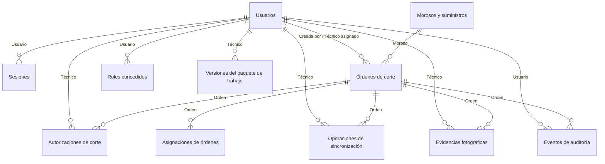

# 04. Modelo de datos

Fuente: migraciones `backend/sql/001` a `008`.
Fecha: 2026-10-13
Estado: entrega, copia fechada. Es el modelo del piloto provisional, no el modelo oficial de SEPSA. Las columnas están en el diccionario de datos.

El modelo tiene 13 tablas, 147 columnas y 21 relaciones.

| Tabla (nombre técnico) | Para qué sirve |
|---|---|
| `users`, `user_role_grants`, `sessions` | Cuentas, roles concedidos y sesiones activas |
| `debtors` | Morosos y suministros cargados |
| `orders`, `order_assignments` | Órdenes de corte y su historial de asignación |
| `command_operations` | Operaciones de comando ejecutadas por un usuario |
| `cut_authorizations` | Autorizaciones de corte y de reconexión, de un solo uso |
| `sync_operations` | Operaciones enviadas desde el dispositivo, con su contenido completo |
| `evidence_assets` | Fotos de evidencia y su huella SHA-256 |
| `work_package_versions` | Versión del paquete entregado a cada técnico y dispositivo |
| `audit_events` | Auditoría, solo de escritura adicional |
| `payment_observations` | Legado de pagos, sin uso operativo en el piloto |

## Diagrama

## Restricciones relevantes

Estas reglas están en la base de datos, no solo en la aplicación:

- Un suministro no puede tener dos órdenes activas para el mismo propósito.
- Una habilitación de reconexión activa es única por orden.
- El identificador de cada autorización y de cada operación de sincronización es único. Una autorización no se reutiliza con otra operación ni con otro token.
- La tabla de pagos rechaza `UPDATE` y `DELETE` con un disparador.

## Supuesto pendiente

`debtors` tiene una cuenta y un suministro, ambos únicos, y no hay tabla de clientes. La relación definitiva la define SEPSA. `TODO: VALIDAR CON SEPSA`
