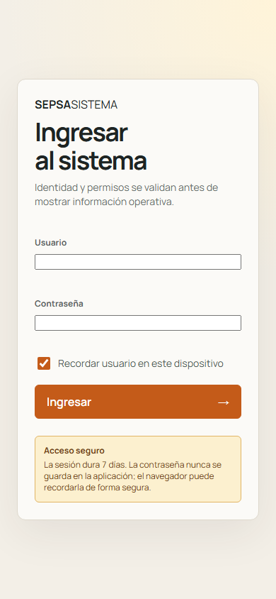
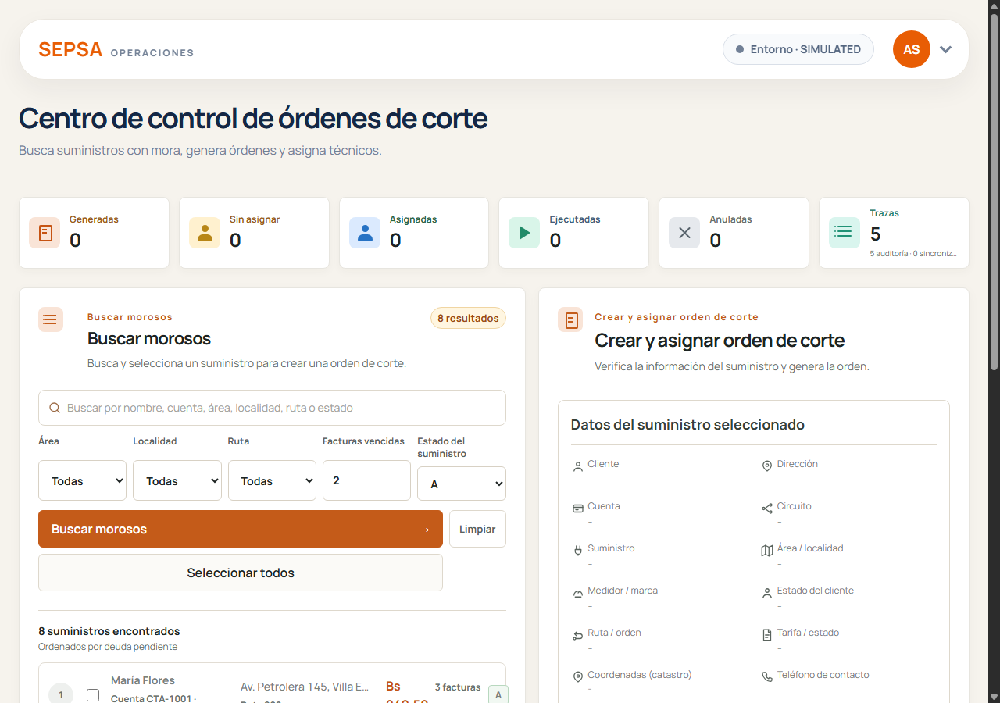
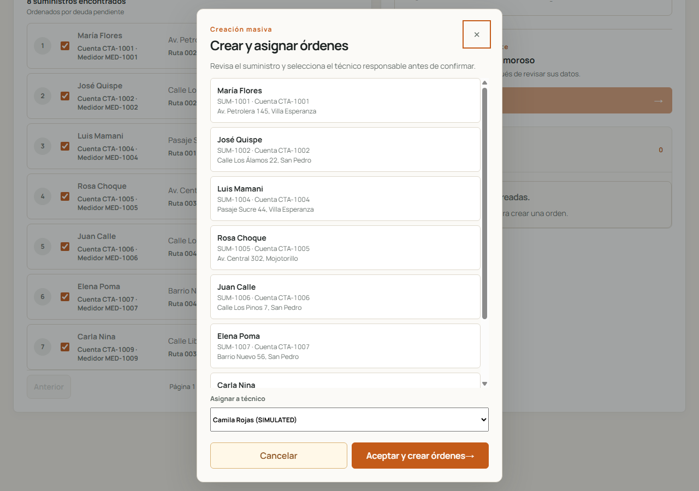
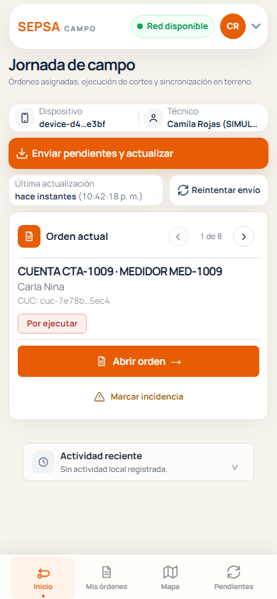
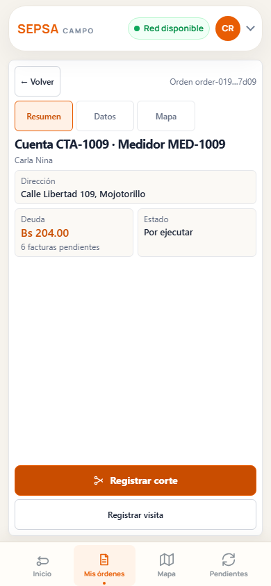
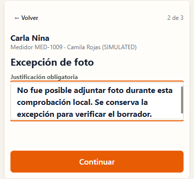

# Manual de usuario

Fuente: `docs/features/assignments.md`, `docs/features/cuts.md`, `docs/features/readings.md`, `docs/features/synchronization.md`, `docs/RULES.md`, `docs/operations/guia-de-campo.md`, `field-app/src/components/` (etiquetas), `field-app/src/utils/error-catalog.ts`, `docs/DECISIONS.md` (D002, D017, D022, D024), capturas del smoke de interfaz del 2026-10-12.
Fecha: 2026-10-13
Estado: entrega, copia fechada. Describe la interfaz tal como está en `main` al 2026-10-12.

Este manual tiene dos partes: la del administrador, que busca morosos y crea órdenes de corte, y la del técnico de campo, que registra visitas y cortes. La guía de campo en PDF es el material de bolsillo del técnico; este manual la complementa.

**Las capturas son de demostración.** Muestran el modo simulado (la cabecera dice `SIMULATED`), con datos ficticios. Los nombres, cuentas y montos no son reales.

Los términos técnicos están en el [glosario](05-diccionario-datos.md#glosario-de-términos-y-estados).

## 1. Regla principal

**Sin autorización en línea vigente, no hay corte.** Si la aplicación no confirma la autorización en ese momento, el técnico registra una visita. El corte solo puede ocurrir cuando la autorización se confirma en línea (`docs/RULES.md`, RF-17). Sin conexión se puede trabajar y registrar, pero no se corta.

## 2. Administrador

### 2.1 Entrar y cambiar de rol

1. Escribir el usuario y la contraseña en la pantalla de acceso y pulsar **Ingresar**. La pantalla indica que la contraseña nunca se guarda en la aplicación; el navegador puede recordarla de forma segura. La casilla **Recordar usuario en este dispositivo** está en la misma pantalla.

   

   La pantalla dice «La sesión dura 7 días», y el despliegue usa el mismo valor (D025).

2. Si la cuenta tiene los dos roles, el menú de perfil ofrece **Cambiar a Técnico** o **Cambiar a Administrador**. El cambio requiere conexión y conserva el dispositivo y los datos locales (`docs/ARCHITECTURE.md`, RF-01).

### 2.2 Panel de control

El panel muestra seis indicadores: **Generadas**, **Sin asignar**, **Asignadas**, **Ejecutadas**, **Anuladas** y **Trazas**. La tarjeta **Trazas** cuenta los eventos de auditoría y de sincronización. **Anuladas** cuenta las órdenes anuladas; el piloto no permite anular órdenes (sección 2.6).

### 2.3 Buscar morosos

En **Buscar morosos**:

- Escribir en el buscador por nombre, cuenta, área, localidad, ruta o estado, o usar los filtros **Área**, **Localidad**, **Ruta**, **Facturas vencidas** y **Estado del suministro**.
- Pulsar **Buscar morosos**. **Limpiar** borra la búsqueda.
- Los resultados aparecen **ordenados por deuda pendiente**.
- Marcar uno o varios suministros con su casilla, o pulsar **Seleccionar todos**.

Revisar el contexto de cada suministro antes de crear la orden: cliente, dirección, cuenta, medidor, deuda y estado. Si ya existe una orden activa para el mismo suministro, no se crea otra (RF-05).

### 2.4 Crear y asignar una orden de corte

1. Con los suministros seleccionados, pulsar **Crear orden de corte** o **Crear y asignar orden de corte**. Se abre la ventana **Creación masiva**. Puede usarse con uno o con varios suministros.
2. En la ventana, revisar la lista de suministros. Se pueden desmarcar los que no se quieren crear.
3. Elegir el técnico en **Asignar a técnico**.
4. Pulsar **Aceptar y crear órdenes**, o **Cancelar** para salir sin cambios.

Cada orden queda con su creador, su técnico, su versión y su estado (`GENERADO`), y la acción queda en auditoría (RF-08). Si la versión de la orden cambió mientras se asignaba, el sistema no sobrescribe la asignación (RF-06).

### 2.5 Operaciones por conciliar (solo lectura)

La sección **Operaciones por conciliar** lista lo que el servidor sabe que está pendiente de conciliar (RF-37):

- conflictos de sincronización;
- autorizaciones usadas cuya operación todavía no llegó del dispositivo;
- operaciones cerradas porque su autorización no se usó.

La sección dice: «Solo lectura. El técnico las verifica o las resuelve desde su dispositivo.» El administrador no puede resolverlas desde la interfaz (D024). Si no hay nada pendiente, muestra «Sin operaciones por conciliar.».

### 2.6 Lo que el administrador no puede hacer en el piloto

- **Anular una orden.** El piloto no tiene esta acción (RF-09).
- **Resolver desde la interfaz una operación incierta.** La revisión con motivo existe solo como API (RF-32).

## 3. Técnico de campo

### 3.1 Antes de salir (con internet)

1. Conectarse a WiFi o a datos.
2. Abrir **SEPSA Campo** desde el icono de la aplicación. No abrirla desde un mensaje.
3. Pulsar **Enviar pendientes y actualizar** para descargar las órdenes asignadas. Si hay operaciones pendientes, se envían primero.
4. Revisar que la cabecera muestre **Red disponible**.

No borres los datos del navegador: ahí están tus órdenes y tus operaciones pendientes. Cerrar sesión no las borra.

### 3.2 Inicio de la jornada

La pantalla **Jornada de campo** muestra el dispositivo, el técnico, la hora de la última actualización y la **Orden actual**, con el número de orden dentro del total (por ejemplo, «1 de 8»). **Abrir orden** muestra el detalle. **Marcar incidencia** registra un problema en la orden.

La barra inferior tiene cuatro secciones: **Inicio**, **Mis órdenes**, **Mapa** y **Pendientes**.

### 3.3 Detalle de la orden

El detalle tiene tres pestañas: **Resumen**, **Datos** y **Mapa**. En **Resumen** se ven la cuenta, el medidor, la dirección, la deuda, las facturas pendientes y el estado (por ejemplo, **Por ejecutar**).

Desde ahí se elige entre dos acciones:

- **Registrar corte**: solo si hay autorización en línea en ese momento.
- **Registrar visita**: registra la presencia en el domicilio. No afirma que hubo corte.

### 3.4 Registrar un corte

Para registrar un corte se capturan:

1. **Lectura final del medidor**: un número en kWh, no negativo, del medidor correcto (RF-14).
2. **GPS**: la ubicación. Si no se puede obtener, se registra una excepción con motivo.
3. **Fotografía**: JPEG o PNG. Si no se puede tomar, la aplicación pide una **Justificación obligatoria** y sigue con la excepción (RF-16).

Antes de cortar, la aplicación pide la autorización en línea. Si el servidor la rechaza o la respuesta no es concluyente, la aplicación no corta. En esos casos registra una visita y muestra un mensaje que indica que el corte no quedó autorizado (por ejemplo, «Se registró una visita; el corte no quedó autorizado.»).

### 3.5 Guardado, envío y estados

La aplicación confirma cada acción solo después de guardarla en el dispositivo. Un corte o una visita pasa por estos estados:

Etiquetas de la cola de envío (`field-app/src/utils/labels.ts`):

| Etiqueta en la aplicación | Qué significa |
|---|---|
| Pendiente | Guardada en el dispositivo y en la cola para enviar. Todavía no hay confirmación del servidor. |
| Sincronizando | Se está enviando. |
| Sincronizado | El servidor confirmó la operación. |
| Falló | No se envió. Se puede reintentar con el mismo identificador. |
| Revisión humana · no reenviar | El resultado no está claro. No se repite la acción física. |

Etiquetas de la orden:

| Etiqueta | Estado |
|---|---|
| Por ejecutar | Orden generada, sin corte. |
| Ejecutada | Corte registrado. |
| Reconectada | Reposición confirmada. |
| Anulada | Orden anulada. |
| En revisión | Resultado físico incierto. No se repite la acción. |

Estado físico: **Sin ejecución**, **Reclamado** (intención guardada en el dispositivo, sin confirmación del servidor), **Confirmado** o **Resultado incierto**.

Para enviar, pulsar **Enviar pendientes y actualizar** o **Reintentar envío**. La cola se conserva aunque se cierre la aplicación o se pierda la red.

### 3.6 Si la autorización no se usó

Si al verificar un corte o una reconexión incierta el servidor confirma que la autorización venció, fue rechazada o no existe, la aplicación muestra **Solicitar nueva autorización** (D022). Antes de pedir otra, la aplicación confirma con el servidor. La operación anterior se cierra fuera de la cola, con el mensaje «Cerrada: la autorización no se usó. La nueva solicitud queda como otra operación.».

Si la verificación no es concluyente, la acción queda como incierta y no se repite. El botón **Verificar con servidor** vuelve a consultar.

### 3.7 Si algo falla

- **No veo órdenes.** Hace falta internet una vez para descargarlas. Volver a WiFi, abrir **Jornada de campo** y pulsar **Enviar pendientes y actualizar**. La guía de campo dice lo mismo con otras palabras («abri Jornada, sincroniza»).
- **Una reconexión quedó incierta.** Usar **Verificar con servidor** (D017). Si el servidor confirma que la autorización no se usó, la aplicación ofrece **Solicitar nueva autorización** (sección 3.6).
- **Un resultado dice Revisión humana · no reenviar.** No repetir la acción física. Avisar al administrador (sección 2.5).

## 4. Guía de campo

La guía de campo del piloto está en `docs/operations/guia-de-campo.md`. Sustituye al PDF retirado y es la que se entrega al técnico. Este manual incluye los mismos pasos en la sección 3. Si la guía y este manual difieren, manda la aplicación y se corrigen ambos.

El PDF anterior se retiró por estar desactualizado y tener el texto recortado. La guía nueva no usa la palabra «AUTORIZADA».

## 5. Preguntas frecuentes

- **¿Puedo cortar sin internet?** No. Sin autorización en línea vigente no hay corte (RF-17).
- **¿Qué pasa si se cierra la aplicación con una operación pendiente?** La operación queda en la cola y se envía en la siguiente sincronización. No se pierde (RF-28).
- **¿Puedo crear una segunda orden para el mismo suministro?** No, mientras la primera esté activa (RF-05).

## 6. Discrepancias y pendientes

| Tema | Descripción | Referencia |
|---|---|---|
| Guía de campo | Se sustituyó el PDF por una guía propia, verificada contra las etiquetas de la aplicación. | Sección 4 |
| Umbral de 3 meses | Los scripts de carga crean órdenes con ese umbral; la regla no está confirmada. | P-01, [07-manual-tecnico.md](07-manual-tecnico.md), sección 1.1 |
| Revisión desde la interfaz | Solo existe como API. | RF-32, D024 |
| Anulación de órdenes | No existe en el piloto. | RF-09 |
